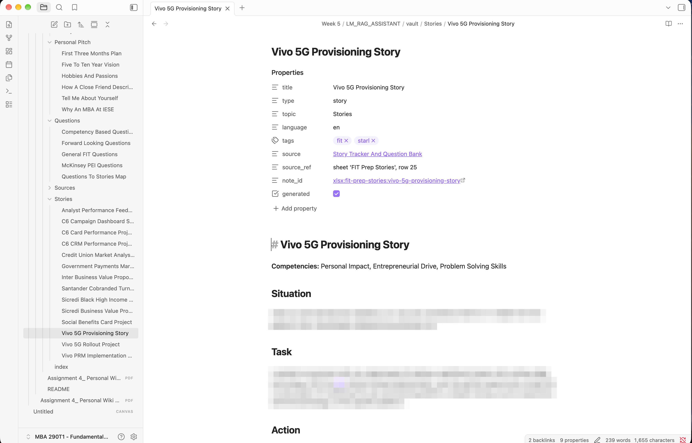
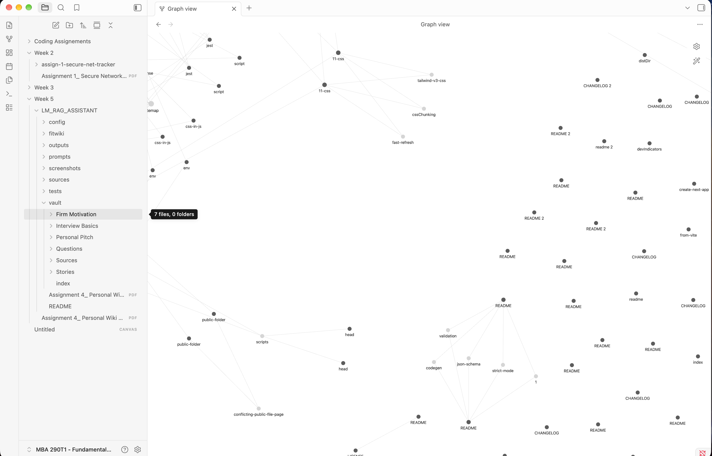
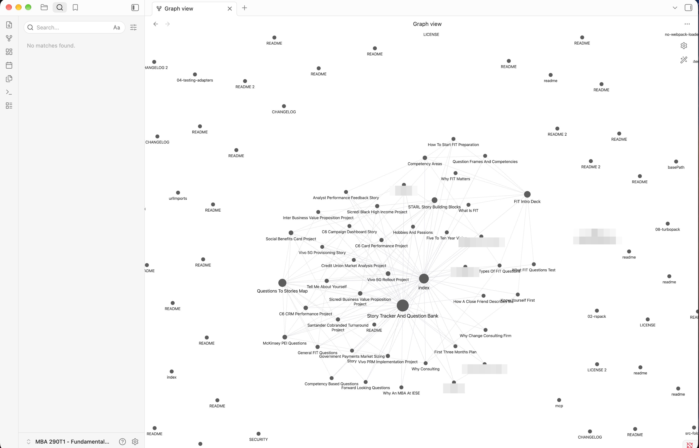
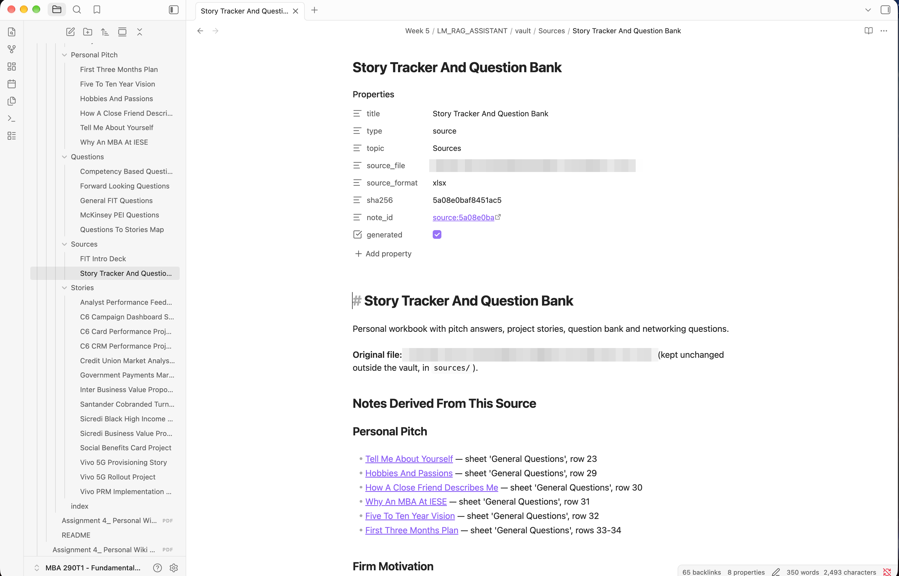

# FitWiki: a personal wiki CLI with local Gemma + RAG

A command-line assistant that runs an open-weight Gemma model **entirely on my laptop** and answers from a personal Markdown wiki that is also browsable in Obsidian. Built for Class 5, Assignment 4 (Fundamentals of Agentic AI). The CLI, the harness and the wiki builder are written from scratch in this repo; only the model runtime (Ollama), the models and a few file-reading libraries are reused.

My wiki is built from two of my own files (a slide deck about consulting FIT interviews and a workbook of my interview answers and stories). **That personal data is not in this repository.** The vault, the search index, copies of my source files, saved chat/ask outputs, raw test evidence and the unredacted Obsidian screenshots are excluded (see `.gitignore`), and quoted passages below are redacted where they come from my private notes. You can run the same system on your own sources (§6).

## 1. What is and is not in this repo

| In the repo | Not in the repo (private) |
|---|---|
| `fitwiki/` (CLI, harness, RAG, retrieval, wiki builder, source readers) | `vault/` (my notes; only `vault/.gitkeep` is tracked) |
| `prompts/` (assistant persona, research rules, router; kept separate) | `.index/` (chunks, vectors, note records), `sources/` (copies of my files) |
| `config/curation.example.json`, `tests/questions.example.json` | `config/curation.json`, `tests/questions.json` (contain my titles and question set) |
| `tests/run_tests.py`, `capture_evidence.py`, `check_vault.py`, `tests/new_source/` (a small test source I wrote) | `tests/results/`, `outputs/`, unredacted `screenshots/` (only blurred copies are published, in `screenshots/public/`) |
| `run_offline_proof.sh`, `wiki` launcher, `requirements.txt` | The assignment PDF |

## 2. Device, runtime and model identity

| Item | Value |
|---|---|
| Machine | Apple M5 Mac (10 CPU cores, 10-core GPU, Metal 4), 24 GB unified memory (no separate VRAM) |
| OS | macOS 27.0 (arm64) |
| Python | 3.14.7, packages in `requirements.txt` (`python-pptx`, `openpyxl`, `numpy`) |
| Runtime | Ollama 0.34.4 on `127.0.0.1:11434` (its model process runs with `--offline`) |
| Chat model | `gemma3n:e4b` (Gemma 3n "E4B"), Ollama digest `15cb39fd9394`, 7.5 GB on disk. The quantization was not reported by `ollama show` on this build and I did not verify it another way, so I do not state one. |
| Embedding model | `nomic-embed-text:latest`, digest `0a109f422b47`, 274 MB |

## 3. Model choice: E2B vs E4B vs 26B A4B MoE

- **E2B / E4B** are Gemma "effective parameter" models sized for laptops. E2B is lightest but weakest at following citation rules; E4B is the middle option.
- **26B A4B** is a mixture-of-experts model: 26B total parameters, about 4B active per token. Active parameters set speed, but **all 26B must be resident in memory**, so its footprint is that of a 26B model (roughly 15-17 GB at 4-bit), not a 4B model.
- **Choice: E4B**, because on 24 GB unified memory it leaves room for macOS, Obsidian, the embedder and a long context. I did not run E2B or the 26B; the choice is by reasoning about the device.

## 4. Retrieval tool vs RAG workflow vs harness

| Layer | What it is here | Code |
|---|---|---|
| **Retrieval tool** | Query in, ranked original passages and paths out. Hybrid ranking (embedding cosine + BM25, reciprocal rank fusion). Never generates text. | `retrieval.py`, `store.py` |
| **RAG workflow** | Fixed `ask` pipeline: retrieve, gate on relevance, numbered evidence in the prompt, temperature 0, citation check, check that capitalized terms exist in the evidence (one corrective retry), then an answer or `INSUFFICIENT_EVIDENCE`. | `rag.py` |
| **Harness** | Everything around the model: modes, prompt files, chat memory and trimming, a routing step that decides whether chat needs the wiki, tool and model calls, error handling (clear message if Ollama is down; no fallback), timing and memory metrics, saved outputs. | `harness.py`, `cli.py` |

Assistant instructions and research rules live in **separate files**: `prompts/assistant.md` (chat persona), `prompts/research_rules.md` (ask rules) and `prompts/router.md` (routing).

| Command | Behavior |
|---|---|
| `chat` | Assistant with personality and conversation memory. A short routing call answers YES / FOLLOWUP / NO; only on YES are passages retrieved and attached to that turn (never stored in history). Casual chat and generic drafting get no notes. `/notes off` disables lookup. |
| `ask "q"` | Standalone, neutral, cited answer from retrieved evidence, or insufficient evidence. Never sees chat history. |
| `search "q"` | Raw passages and paths, no model call. |
| `ingest <file>` | Reads the original (never modified), rebuilds notes, `index.md` and the retrieval index. `.pptx .xlsx .md .txt` supported. |
| `help` | Command summary. |

Connecting code: `llm.chat()` streams from Ollama `/api/chat`; `llm.embed()` calls `/api/embed`; `sources.py` turns slides and sheets into draft notes; `wiki.py` writes the vault; `llm.py` asserts the endpoint is loopback, so there is no cloud path in the code.

## 5. Wiki design (for Obsidian and for retrieval)

- Short descriptive filenames with a matching `# heading` (for example `GPU Parallel Training.md`); `naming.py` rejects hashes, export words, sentence-like titles and duplicates.
- A few topic folders, a grouped `index.md`, meaningful internal links, and a `Sources/` note per original file listing every derived note with its sheet/row or slide reference.
- Machine IDs stay in frontmatter; chunks, vectors and manifests live in `.index/`, outside the vault.
- Originals are only read. Re-ingesting is idempotent: notes are regenerated from stable IDs, unchanged files are not rewritten, replaced notes are archived, hand-edited notes are left alone.
- `tests/check_vault.py` checks filenames, H1 = filename, links, orphans, duplicate filenames and IDs in visible text. On my vault (46 notes): 272 resolved links, 0 broken, 0 orphans, no problems.

## 6. Launch instructions

```sh
# one-time setup (needs internet)
brew install ollama && brew install --cask obsidian
ollama serve &                       # or: brew services start ollama
ollama pull gemma3n:e4b
ollama pull nomic-embed-text
python3 -m venv .venv
.venv/bin/pip install -r requirements.txt

# bring your own sources: copy the example config and fill in titles/folders for your files
cp config/curation.example.json config/curation.json
cp tests/questions.example.json tests/questions.json

# use (works offline)
./wiki help
./wiki ingest "/path/to/your-file.pptx"      # or .xlsx / .md / .txt
./wiki chat                                   # /ask, /search, /notes on|off, /reset, /help, /quit
./wiki ask "your question"
./wiki search "your query"

# tests
.venv/bin/python tests/run_tests.py <label>
.venv/bin/python tests/capture_evidence.py <label>
.venv/bin/python tests/check_vault.py
bash run_offline_proof.sh                     # refuses to run unless the internet is unreachable
```

The readers in `sources.py` are written for my two files' layouts (sheet and column names); other `.pptx`/`.xlsx` files need curation entries or reader changes. `.md` and `.txt` sources work generically, for example `tests/new_source/Coffee Chat Etiquette.md`.

## 7. Results (redacted)

All results below were produced by the real system on the device in §2. Where the source was one of my private notes, the passage is redacted and only the structure is shown.

### Ask mode, answerable questions

| # | Question | Actual answer | Cited passage supports it? |
|---|---|---|---|
| A1 | What are the four competency areas that FIT interviewers assess? | "FIT interviewers assess Personal Impact, Entrepreneurial Drive, Problem Solving Skills, and Leadership [2]." | Yes: passage [2] (a slide-derived note, top-2 of 5 by rank, cosine 0.79) lists exactly these four with definitions. |
| A2 | What are the building blocks of the STARL framework for structuring a story? | "The STARL framework for structuring a story includes Situation, Task, Action, Results, and Learnings [1]." | Yes: passage [1] (cosine 0.76) lists those five blocks. It does not spell out the acronym itself; that link comes from the note title. |
| A3 | A question whose answer sits in one of my personal notes (a question-to-story map) | A short, correct project name with citation [1] | Yes: the rank-1 passage (cosine 0.74) contained it. **Passage and answer redacted (private).** |

### Ask mode, unsupported question

**"What was Bain & Company's global revenue in 2024?"** The top-5 retrieved passages were all personal notes about one firm (cosine 0.53-0.62; **redacted**), none mentioning revenue. Actual response:

```
INSUFFICIENT_EVIDENCE: The provided passages do not contain information about Bain & Company's global revenue in 2024.
```

The retrieval gate (top cosine < 0.50) did **not** stop this question, because the wiki mentions the firm; the refusal came from the model following the research rules. A fully off-topic question would be stopped by the gate before the model is called, but I did not test that separately.

### Source ingested offline (test file in this repo)

**N1. "How soon after a coffee chat should a thank-you note be sent?"** Retrieved rank 1: `Coffee Chat Etiquette.md`, "After the chat" (cosine 0.94): "Send a thank-you note within 24 hours. Mention one specific thing you learned and one follow-up action you will take." Answer: "A thank-you note should be sent within 24 hours [1]. The note should mention one specific thing learned and one follow-up action [1]." Both claims are supported.

### Failures found and fixes

| # | What happened | Fix |
|---|---|---|
| 1 | On A3 the model garbled a project-note name mid-word (reproducible at temperature 0), even though retrieval was right. | Added a grounding check in `rag.py`: capitalized words in the answer that appear in neither the evidence nor the question trigger one corrective retry; if still unmatched the answer is flagged. |
| 2 | A2 appended an unrelated list from the slide. | Tightened rule 8 in `research_rules.md`. |
| 3 | The source deck repeats identical speaker notes on several slides, so STARL retrieval returned unrelated passages. | `sources.py` keeps each identical note text once. |
| 4 | Gemma output leaked `▁▁▁` tokenizer characters. | Stripped in `llm.py`. |
| 5 | Chat did not use the wiki at all. | Added a routing step. Cosine thresholds could not separate casual messages (0.62 for "Tell me a joke") from real notes questions (0.59), so a model router is used. It scored 15/16 on my small check; the miss was borderline. |
| 6 | An early router carried notes into an unrelated turn. | Added a FOLLOWUP outcome with previous-turn context. |
| 7 | My follow-up test needed exact word overlap and wrongly failed a correct answer ("Bubble" vs "Bubbles"). | Loosened to word stems. That test's pass depends on a change I made after seeing the result. |
| 8 | The offline log exposed two notes with the same filename (a content note and its source note), so links were ambiguous; my check compared them separately. | Source-note titles for unnamed sources now end in "Source"; `wiki.py` rejects title collisions; `check_vault.py` reports duplicate filenames; `ingest.py` replaces a source by original filename. Fixed after the offline run (online); offline evidence predates the fix. |

## 8. Offline run

**Command:** `bash run_offline_proof.sh`, which (1) aborts unless `curl https://example.com` and `ping 8.8.8.8` both fail, (2) restarts Ollama and the CLI cold, (3) ingests a new source twice, (4) runs `help`, `search`, three `ask` commands and a scripted `chat`, (5) runs the test suite, evidence capture and vault check, and (6) re-checks that it is still offline. (The public script uses generic prompts; my evidence run used prompts about my private notes.) Started 2026-09-28 23:31:57 PDT.

```
$ curl -sS -m 6 https://example.com
curl: (6) Could not resolve host: example.com
$ ping -c 2 -t 3 8.8.8.8
ping: sendto: No route to host
2 packets transmitted, 0 packets received, 100.0% packet loss

$ curl -s http://127.0.0.1:11434/api/version        # after cold restart of Ollama
{"version":"0.34.4"}

$ ./wiki ingest tests/new_source/Coffee Chat Etiquette.md
Ingested Coffee Chat Etiquette: 1 notes. Vault: 3 written, 43 unchanged, 0 archived, 0 skipped (hand-edited). Index: {'chunks': 130, 'embedded': 3, 'reused': 127}
$ ./wiki ingest tests/new_source/Coffee Chat Etiquette.md      # repeat
Ingested Coffee Chat Etiquette: 1 notes. Vault: 0 written, 46 unchanged, 0 archived, 0 skipped (hand-edited). Index: {'chunks': 130, 'embedded': 0, 'reused': 130}

... (help, search, ask, chat, suite) ...
11/11 passed
$ curl -sS -m 6 https://example.com
curl: (6) Could not resolve host: example.com
still offline: OK
```

**11 of 11 checks passed:** ask A1, A2, A3, U1 (unsupported) and N1 (source ingested offline); raw search (`model_called: false`); casual chat and drafting (no notes used, no retrieval call); wiki-aware chat (the right personal note was pulled into context); follow-up (turn 2 answered "**Bubble** is the funniest" from the goldfish names in turn 1); ask/chat separation (after telling chat "my lucky number is 47", `ask "What is my lucky number?"` returned `INSUFFICIENT_EVIDENCE` and chat history length was unchanged).

### Measurements

| Test | Wall seconds | Model seconds | Tokens generated, tokens/s | Peak Ollama RSS |
|---|---|---|---|---|
| ask A1 | 0.85 | 0.69 | 21, 34.8 | 4,356 MB |
| ask A2 | 2.82 | 2.73 | 26, 33.7 | 4,392 MB |
| ask A3 | 1.97 | 1.92 | 20, 71.4 | 4,452 MB |
| ask U1 (unsupported) | 1.15 | 0.99 | 31, 34.5 | 4,528 MB |
| ask N1 | 2.83 | 2.63 | 36, 33.5 | 4,544 MB |
| search (no model) | 0.28 | none | none | 4,542 MB |
| chat casual | 2.25 | 1.39 (+0.84 routing) | 36, 34.5 | 4,578 MB |
| chat drafting | 3.97 | 2.93 (+0.81 routing) | 93, 34.1 | 4,581 MB |
| chat with wiki notes | 4.82 | 3.72 (+0.82 routing) | 100, 34.2 | 4,582 MB |
| chat follow-up (turn 2) | 2.83 | 1.85 (+0.83 routing) | 56, 34.4 | 4,586 MB |
| ask/chat separation | 0.84 | n/a | n/a | 4,592 MB |

- After the run Ollama reported `gemma3n:e4b` at 3,052 MB and `nomic-embed-text` at 370 MB loaded (both on the GPU); total Ollama RSS about 4.6 GB of 24 GB. At the end 39% of memory was free and swap was 4,466 MB of 6,144 MB, already in use before the run from other apps.
- Generation was about 34 tokens/s; retrieval takes 0.01-0.02 s once the embedder is warm. The first `ask` after the cold restart took 5.71 s end to end (includes loading Gemma; load time was not separated).
- **Unexplained:** the A3 runs generated at 71-74 tokens/s, double everything else. Separately, some online development runs after a manual Ollama restart showed Gemma at 7,749 MB and about 8.4 GB total RSS; the cold restart in the offline run showed the 3,052 MB / 4.6 GB figures above. A later full re-run on the same, longer-running Ollama server showed about 7.9-8.3 GB peak RSS again with all 11 checks passing. I did not find the cause, so treat the 4.6 GB figure as the cold-start case and roughly 8 GB as what I also observed on a warmed, longer-running server.

## 9. Obsidian evidence (redacted)

Screenshots taken 2026-09-28 (23:25-23:27), before the offline run, when the vault had 44 notes. **Pixelated for privacy:** the body text of my story note, the names of the firms I am applying to (graph labels), one stray node from a saved question, and the original workbook's file name (it contains my full name). Everything else is as captured. Obsidian was opened on the *parent course folder*, not on `vault/` alone (the breadcrumb reads `Week 5 / LM_RAG_ASSISTANT / vault / Stories / ...`), so the explorer and graph also contain unrelated course files.

**An open note.** Short descriptive filename (tab and breadcrumb), the `# heading` matching the filename, properties with a `source` link and `source_ref` (`sheet 'FIT Prep Stories', row 25`), an inline link ("5G") to the related project note, and 2 backlinks. `note_id` appears only as a property, not in the note text. The `## Related` and `## Sources` sections are below the visible area; I read them from the file (trace below).



**Topic-organized page list.** The explorer shows `vault/` with its six topic folders (Firm Motivation, Interview Basics, Personal Pitch, Questions, Sources, Stories) and `index.md`; the tooltip "7 files, 0 folders" on Firm Motivation matches its seven notes. The graph in the background is unrelated course material and is not evidence for the wiki.



**Graph view. Filter used: none; no attachments hidden** (the search box says "No matches found" because it is the search panel, not a graph filter). The wiki forms the dense cluster in the center with readable labels; the largest hubs are the source catalog note, `index`, the deck's source note and the question-to-story map, as designed (every note links to its source note and to `index`). What is wrong with this screenshot: many unrelated `README`/`CHANGELOG` nodes from other projects in the same parent folder surround the cluster, a few labels overlap, and it was not retaken with a filter such as `path:"LM_RAG_ASSISTANT/vault"`.



**Source catalog.** The source note lists the original file (blurred here), its `sha256` prefix, and every derived note grouped by topic with its sheet/row or slide reference; 65 backlinks.



**One traced path** (checked against the files after the screenshots): a story note (`source_ref: sheet 'FIT Prep Stories', row 25`) links in `## Related` to a project note (`source_ref: sheet 'Historias', rows 14-15`); both link in `## Sources` to the source catalog note, which lists both notes with those references and records the original's `sha256` prefix `5a08e0baf8451ac5`. I recomputed the hash of the original workbook after the offline run and it starts with the same prefix (the copy in `sources/` too), and the original's modification date is unchanged (Jan 15 2026). Reading the original workbook directly, the cells on those sheets and rows hold the same text as the notes. `check_vault.py` resolved 272 links with 0 broken and 0 orphans, and re-ingesting wrote 0 files (§8).

## 10. Known limits

- E4B is a small model. It garbled a name once; the grounding check catches capitalized terms, not every kind of error.
- The retrieval gate only stops off-topic questions; on-topic unsupported ones rely on the model's refusal.
- The router is a prompt, not a trained classifier; it can miss or over-trigger.
- `nomic-embed-text` is English-centric while many of my notes are Portuguese; retrieval worked on my tests but was helped by keyword matching.
- The source readers are specific to my two files' layouts.
- Local mode only; no online mode was built.
- The test set is small (four ask questions plus chat and search checks); passing it does not prove general accuracy.
